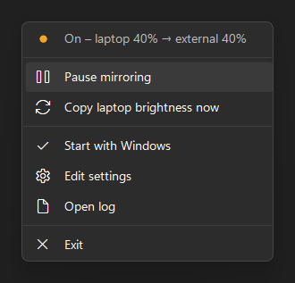
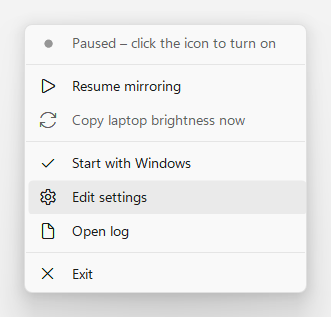

# Brightness Mirror

**Make the Windows brightness slider control your external monitor too.**

On a laptop, Windows' brightness controls only change the built-in screen. Brightness Mirror is a
small tray app that watches the laptop's brightness and copies every change to your external
monitors over DDC/CI. The Quick Settings slider, the brightness keys and Settings then control
every screen at once.

<p>
  
  
</p>

## Features

- **Uses the controls you already have:** the Quick Settings slider (Win+A), the Fn brightness keys and
  Settings › Display.
- **Smooth while dragging:** rapid changes are merged so the monitor isn't flooded, and the final
  value is always applied.
- **Tray icon status:** shows whether mirroring is on, paused or has a problem. Hover over it for the
  last change, and left-click to pause or resume.
- **Windows 11-style menu** that follows the system light/dark mode.
- **Start with Windows** from the tray menu, as a regular startup app that you can also switch off in
  Task Manager.
- **Installer:** installs to Program Files or just for you, with a Start menu entry and a clean
  uninstall.
- **Optional mapping:** for example, keep the external monitor a bit brighter than the laptop.
- **Finds the monitor again** after sleep, unplugging, or display changes.
- **No dependencies:** one small `.exe`, built with the C# compiler that ships with Windows.

## Requirements

- Windows 10 or 11. .NET Framework 4.8 is built in.
- A built-in screen whose brightness Windows can change, such as a laptop panel.
- An external monitor with **DDC/CI** turned on. It's in the monitor's own on-screen menu and is
  usually on by default. Direct DisplayPort or HDMI works best, because some docks and adapters
  block DDC/CI.

## Install

1. Download `BrightnessMirror-Setup-<version>.exe` from [Releases](../../releases) and run it.
   The installer isn't code-signed, so SmartScreen may warn you. Choose **More info › Run anyway**,
   or build it yourself (below).
2. Choose who to install for:
   - **All users** (the default) installs to `C:\Program Files\Brightness Mirror` and needs admin rights.
   - **Only for me** installs to `%LOCALAPPDATA%\Programs\Brightness Mirror` without admin rights.

   On the next page you can pick a different folder.
3. Leave **Start Brightness Mirror when I sign in to Windows** ticked if you want it to start
   automatically. You can change this later from the tray menu.

The installer adds a Start menu entry. To uninstall, use Settings › Apps › Installed apps. Uninstalling
also removes the startup entry and your settings.

### Build from source

No SDK is needed. The C# compiler ships with Windows, and the installer is built with
[Inno Setup 6](https://jrsoftware.org/isinfo.php). From the repository folder, run:

```powershell
powershell -ExecutionPolicy Bypass -File build.ps1
```

The output goes to `build\`: `BrightnessMirror.exe` and `BrightnessMirror-Setup-<version>.exe`. Without
Inno Setup, only the exe is built.

To skip the installer, `install.ps1` builds the exe and installs it for the current user in
`%LOCALAPPDATA%\Programs\BrightnessMirror`, adds it to startup apps and starts it. `install.ps1 -Uninstall`
removes it again.

## Usage

Windows 11 hides new tray icons. Click **^** next to the clock and drag the sun icon onto the taskbar,
or turn it on in Settings › Personalization › Taskbar › Other system tray icons.

| Icon | Meaning |
|---|---|
| Amber, filled sun | On. Hover over it to see the last change, e.g. *On – laptop 40% → external 40%*. |
| Grey, hollow sun | Paused. Laptop brightness changes are ignored. |
| Red sun | No external monitor answered, or the last change failed. Hover to see which. |

- **Left-click** pauses or resumes. When you resume, the laptop's current brightness is copied right
  away. The paused state is remembered after a restart.
- **Right-click** opens a menu with these items:
  - the current status
  - Pause/Resume mirroring
  - Copy laptop brightness now
  - Start with Windows
  - Edit settings
  - Open log
  - Exit

Starting the app never changes the monitor. It only reacts when the laptop brightness changes. After
**Exit**, start it again from the Start menu.

### Start with Windows

The tray menu's **Start with Windows** item adds a normal startup-app entry for your user account.
Task Manager › Startup apps and Settings › Apps › Startup list it as **Brightness Mirror**, and you can
switch it on or off in any of the three places. The check mark always shows the current state.

## Settings

Settings live in `%LOCALAPPDATA%\BrightnessMirror\BrightnessMirror.ini`. Open it with
right-click › **Edit settings**. Changes take effect on the next brightness change, with no restart
needed.

| Key | Default | Meaning |
|---|---|---|
| `MinOutput` | `0` | External brightness (%) when the laptop is at 0%. |
| `MaxOutput` | `100` | External brightness (%) when the laptop is at 100%. Values in between are scaled linearly. |
| `IntervalMs` | `150` | Minimum gap between commands to the monitor (50–2000). Raise it if your monitor misses changes. |

Example: `MinOutput=10` keeps the external monitor 10 points brighter at the dark end.

## How it works

- Windows announces every change to the built-in panel's brightness with the
  `GUID_VIDEO_CURRENT_MONITOR_BRIGHTNESS` power-setting notification. A hidden window subscribes to it
  with `RegisterPowerSettingNotification`.
- A background thread sends the new level to every monitor that answers DDC/CI, using VCP code
  `0x10` (brightness) through `dxva2.dll`. Built-in panels don't speak DDC/CI, so they're skipped
  automatically.
- Monitors are re-scanned at start, after resume or a display change, and whenever a command fails.
- The log, `BrightnessMirror.log`, sits next to the settings in `%LOCALAPPDATA%\BrightnessMirror` and is
  capped at 256 KB. The app never writes next to its exe, so it can run from Program Files.

## Limitations

- It works only while the built-in screen is on. With the lid closed, Windows has no brightness slider,
  so there's nothing to mirror.
- All external monitors follow the same level.
- Other brightness tools, such as Twinkle Tray, won't show changes made by Brightness Mirror until
  they refresh.
- The app is system-DPI aware, so its menu can look slightly soft on a screen whose scaling differs
  from your main display.

## Troubleshooting

- **Red icon, "No external monitor answers (DDC/CI)":** turn on DDC/CI in the monitor's menu, then
  try a direct cable instead of a dock or adapter.
- **Something else:** right-click › Open log.

## License

[GNU General Public License v3.0](LICENSE)
